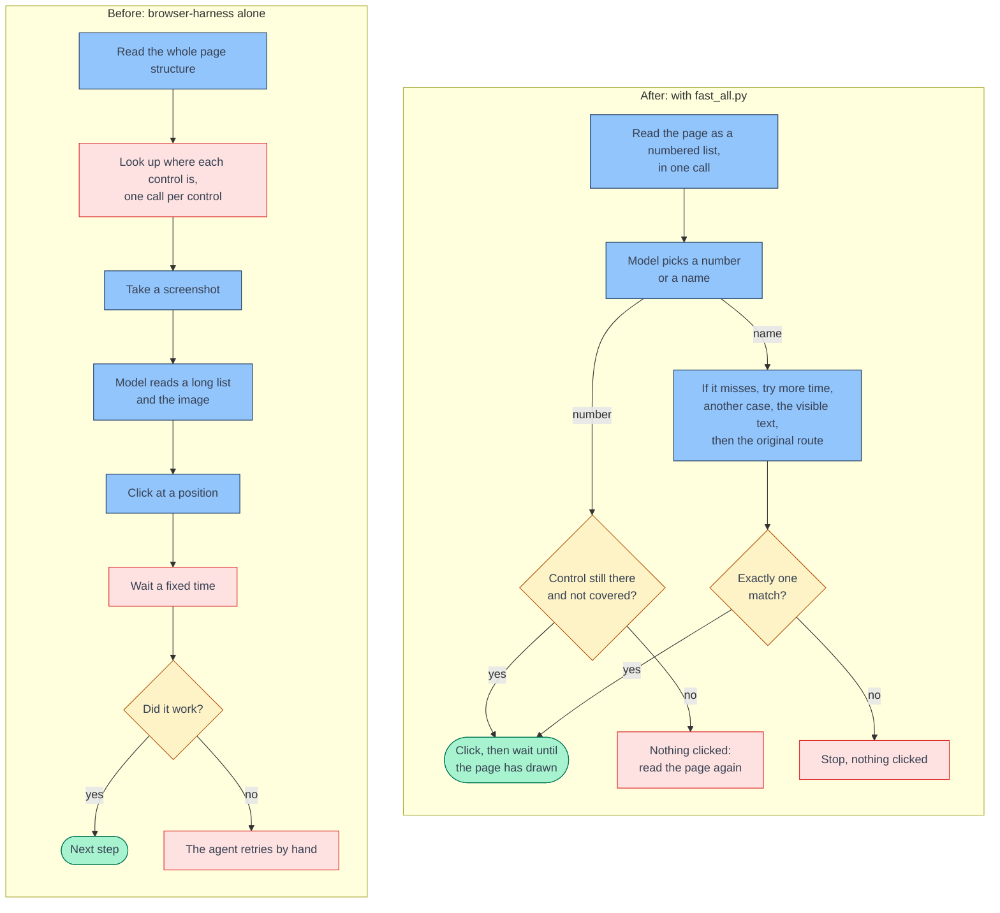
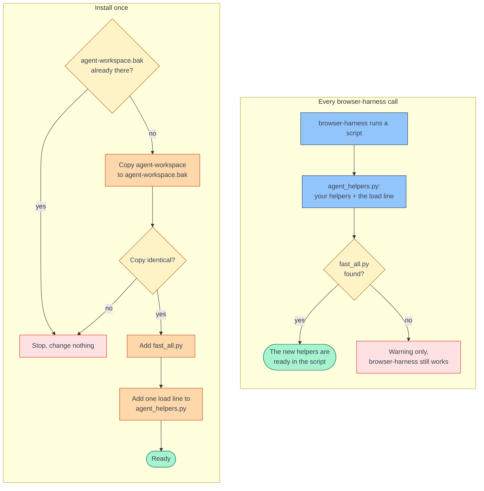

# fast-browser-harness

fast-browser-harness makes [browser-harness](https://github.com/browser-use/browser-harness) agents read pages
faster. One file, `fast_all.py`, adds helpers that read a page in one browser call and click by number. On three
public pages, one look took 5 to 19 ms and one call. The accessibility-tree route took 0.3 to 10 seconds and 178 to
1,672 calls. The model only has to answer with a number, so a small model such as Claude Haiku can do it.



## What it changes

```text
              browser-harness alone                     with fast_all.py
read    accessibility tree + one box per control     snapshot(): one call, a numbered map
        + a screenshot (178 to 1,672 calls)          [2] searchbox "Search Wikipedia"
act     click_at_xy(x, y)                            click_idx(2): checks the element first
wait    a fixed sleep                                settle(): two animation frames
miss    the agent retries by hand                    click_name(): repairs, then falls back
                                                     to the accessibility tree
```

Your `browser-harness` command stays as it is. The helpers live in your agent workspace, next to your own.

## Install

Install makes an exact backup of your agent workspace first and checks it. It changes nothing unless the backup is
in place. Two files change, both in your browser-harness agent workspace:

```text
~/.config/browser-harness/          ($BH_AGENT_WORKSPACE, if you set it, replaces agent-workspace/)
├── agent-workspace/
│   ├── agent_helpers.py            your helpers, plus one load line added at the end
│   └── fast_all.py                 new: the helpers from this repository
└── agent-workspace.bak/            new: the backup, an identical copy made before any change
```



### With Claude

Paste this into Claude Code:

```text
Install fast-browser-harness into my browser-harness. Run the "By hand" install command from
https://github.com/<owner>/fast-browser-harness#by-hand exactly as written, as one command, without changing it.
It backs up my agent workspace to agent-workspace.bak and checks the copy before it changes anything. If it prints
"stopped", tell me why and change nothing. Then prove it works: open https://en.wikipedia.org with browser-harness,
print snapshot(), click the search box with click_idx, and tell me what you saw.
```

### By hand

Paste this into a terminal as one command:

```bash
WS="${BH_AGENT_WORKSPACE:-$HOME/.config/browser-harness/agent-workspace}"
mkdir -p "$WS" \
  && { test ! -e "$WS.bak" || { echo "stopped: $WS.bak already exists. Nothing was changed."; false; }; } \
  && cp -Rp "$WS" "$WS.bak" \
  && diff -r "$WS" "$WS.bak" \
  && echo "backup ok, identical copy: $WS.bak" \
  && curl -fsSL https://raw.githubusercontent.com/<owner>/fast-browser-harness/main/fast_all.py -o "$WS/fast_all.py" \
  && echo >> "$WS/agent_helpers.py" \
  && sed -n 's/^#   \(import os as _o, sys as _s; .*\)$/\1/p' "$WS/fast_all.py" >> "$WS/agent_helpers.py" \
  && echo "installed: $WS/fast_all.py, and one load line at the end of $WS/agent_helpers.py"
```

If `agent-workspace.bak` is already there from an earlier install, revert first or move it away.

## Revert

Revert puts the backup back in place of the whole workspace. Anything you added to the workspace after the install
is lost, so copy it out first.

With Claude:

```text
Revert fast-browser-harness. Run the "Revert" command from
https://github.com/<owner>/fast-browser-harness#revert exactly as written, as one command, without changing it.
Before you run it, show me what is in agent-workspace and agent-workspace.bak and wait for my yes.
```

By hand:

```bash
WS="${BH_AGENT_WORKSPACE:-$HOME/.config/browser-harness/agent-workspace}"
test -d "$WS.bak" \
  && rm -rf "$WS" \
  && mv "$WS.bak" "$WS" \
  && echo "reverted: $WS is the backup again"
```

## Only one extension

To add one piece instead of all of them, set `NAME` and run this command. It makes the same backup and checks it,
then appends that extension to the end of `agent_helpers.py`.

```bash
NAME=indexed_map   # or frame_wait, click_repair, marked_shot
WS="${BH_AGENT_WORKSPACE:-$HOME/.config/browser-harness/agent-workspace}"
mkdir -p "$WS" \
  && { test ! -e "$WS.bak" || { echo "stopped: $WS.bak already exists. Nothing was changed."; false; }; } \
  && cp -Rp "$WS" "$WS.bak" \
  && diff -r "$WS" "$WS.bak" \
  && echo "backup ok, identical copy: $WS.bak" \
  && echo >> "$WS/agent_helpers.py" \
  && curl -fsSL "https://raw.githubusercontent.com/<owner>/fast-browser-harness/main/extensions/$NAME.py" >> "$WS/agent_helpers.py" \
  && echo "installed: extensions/$NAME.py, added at the end of $WS/agent_helpers.py"
```

| `NAME` | Adds |
|---|---|
| [`indexed_map`](extensions/indexed_map.py) | `snapshot`, `click_idx`, `type_idx` |
| [`frame_wait`](extensions/frame_wait.py) | `settle`, `wait_until` |
| [`click_repair`](extensions/click_repair.py) | `click_name`, `click_text` with repair and the accessibility-tree fallback |
| [`marked_shot`](extensions/marked_shot.py) | `capture_marked`, a screenshot with boxes on chosen controls |

## Credit

The technique comes from [jev-ultrafast](https://github.com/browser-use/jev-ultrafast) by Browser Use. It uses an
indexed page snapshot in one call, frame-based waits with focus emulation, and a hit test before each click. The code
here is new and written for browser-harness. The browser-harness README is at
[browser-use/browser-harness](https://github.com/browser-use/browser-harness).
