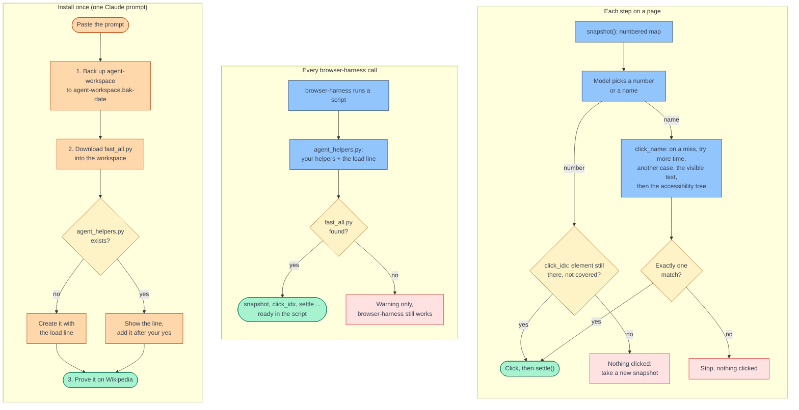

# fast-browser-harness

fast-browser-harness makes [browser-harness](https://github.com/browser-use/browser-harness) agents read pages
faster. One file, `fast_all.py`, adds helpers that read a page in one browser call and click by number. On three
public pages, one look took 5 to 19 ms and one call. The accessibility-tree route took 0.3 to 10 seconds and 178 to
1,672 calls. The model only has to answer with a number, so a small model such as Claude Haiku can do it.



## What it changes

```text
              browser-harness alone                     with fast_all.py
read    accessibility tree + one box per control     snapshot(): one call, a numbered map
        + a screenshot (178 to 1,672 calls)          [2] searchbox "Search Wikipedia"
act     click_at_xy(x, y)                            click_idx(2): checks the element first
wait    a fixed sleep                                settle(): two animation frames
miss    the agent retries by hand                    click_name(): repairs, then falls back
                                                     to the accessibility tree
```

Your `browser-harness` command stays as it is. The helpers live in your agent workspace, next to your own.

## Install

The prompt backs up your whole agent workspace before it changes anything. Paste it into Claude Code:

```text
Add fast-browser-harness to my browser-harness. Back up first: copy my whole browser-harness agent workspace
($BH_AGENT_WORKSPACE, or ~/.config/browser-harness/agent-workspace) to agent-workspace.bak-<date and time> next
to it, and tell me where the backup is. Change nothing before the backup exists. Then download
https://raw.githubusercontent.com/<owner>/fast-browser-harness/main/fast_all.py into the workspace and load it
from agent_helpers.py with the load line in the header of fast_all.py. If agent_helpers.py already exists, show me
the line you will add and wait for my yes. Then prove it works: open https://en.wikipedia.org with browser-harness,
print snapshot(), click the search box with click_idx, and tell me what you saw.
```

## Revert

Paste this into Claude Code:

```text
Revert fast-browser-harness: replace my browser-harness agent workspace ($BH_AGENT_WORKSPACE, or
~/.config/browser-harness/agent-workspace) with the newest agent-workspace.bak-<date and time> next to it. Show me
which backup you will use and wait for my yes. Then check that browser-harness still runs.
```

## Only one extension

To add one piece instead of all of them, use the install prompt with one file from `extensions/` in place of
`fast_all.py`. Ask Claude to append that file to the end of `agent_helpers.py`, not to add the load line.

| Extension | Adds |
|---|---|
| [`indexed_map.py`](extensions/indexed_map.py) | `snapshot`, `click_idx`, `type_idx` |
| [`frame_wait.py`](extensions/frame_wait.py) | `settle`, `wait_until` |
| [`click_repair.py`](extensions/click_repair.py) | `click_name`, `click_text` with repair and the accessibility-tree fallback |
| [`marked_shot.py`](extensions/marked_shot.py) | `capture_marked`, a screenshot with boxes on chosen controls |

## Credit

The technique comes from [jev-ultrafast](https://github.com/browser-use/jev-ultrafast) by Browser Use. It uses an
indexed page snapshot in one call, frame-based waits with focus emulation, and a hit test before each click. The code
here is new and written for browser-harness. The browser-harness README is at
[browser-use/browser-harness](https://github.com/browser-use/browser-harness).
